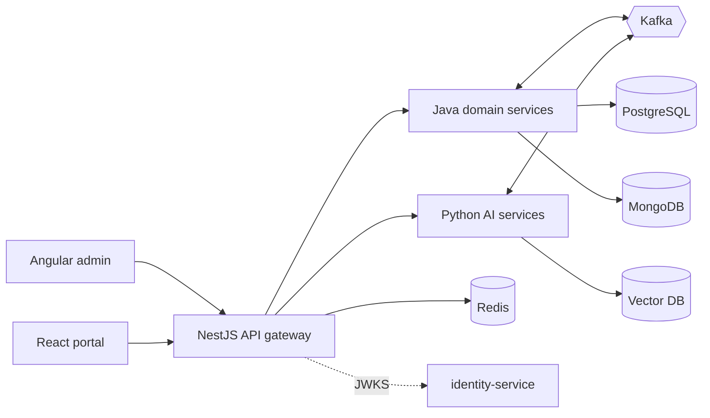

# NEXUS Enterprise — AI-Powered Digital Business Ecosystem

A multi-tenant, event-driven enterprise platform built as a long-term engineering project: Java/Spring Boot microservices, Node.js/NestJS edge services, Python/FastAPI AI services, Angular and React portals, Kafka, PostgreSQL, MongoDB, Redis, Docker, Kubernetes, Terraform and AWS.

> **Project status:** Phase 1 (architecture) is complete; the repository foundation and the first service — **identity-service** (multi-tenant auth, RBAC, RS256 JWT + JWKS, refresh-token rotation with reuse detection) — are implemented with unit and Testcontainers integration tests.
> See **[DEVELOPMENT_STATUS.md](DEVELOPMENT_STATUS.md)** for exactly what is built and tested. Nothing is listed as done unless it is implemented and covered by passing tests.

## Architecture at a glance



| Document | |
| --- | --- |
| [System architecture](docs/architecture/01-system-architecture.md) | Goals, high-level diagram, bounded contexts, module→service mapping |
| [Microservices](docs/architecture/02-microservices.md) | Service catalogue, ports, data ownership, events |
| [API communication](docs/architecture/03-api-communication.md) | REST conventions, error contract, Kafka topics, outbox, WebSockets, GraphQL |
| [Authentication](docs/architecture/04-authentication.md) | Tokens, rotation, RBAC, multi-tenancy, OWASP mapping |
| [AI architecture](docs/architecture/05-ai-architecture.md) | RAG, agents, NL→SQL safeguards, evaluation |
| [Roadmap](docs/architecture/06-roadmap.md) | 15 phases with exit criteria |
| [Decisions (ADRs)](docs/architecture/decisions.md) | Why the architecture looks like this |
| [Database architecture](docs/database/database-architecture.md) | ERDs, conventions, indexing, retention |

## Repository layout

```text
nexus-enterprise-platform/
├── backend/
│   ├── java-services/        Maven multi-module: platform-common, identity-service (+ future services)
│   ├── node-services/        NestJS gateway, realtime, integrations, workers (Phase 6)
│   └── python-ai-services/   FastAPI orchestrator, RAG, document intelligence, NL-SQL (Phase 9)
├── frontend/
│   ├── angular-admin/        Admin portal (Phase 7)
│   └── react-portal/         Business & customer portal (Phase 8)
├── infrastructure/
│   ├── docker/               Dockerfiles, Prometheus/Grafana provisioning
│   ├── kubernetes/           Manifests (Phase 11)
│   └── terraform/            AWS (Phase 14)
├── database/                 Per-service DB bootstrap, cross-service scripts, demo data
├── docs/                     architecture, api, database, deployment, user-guides
├── testing/                  integration, performance, security suites
├── .github/workflows/        CI
├── docker-compose.yml
├── DEVELOPMENT_STATUS.md
├── CONTRIBUTING.md
└── LICENSE
```

## Quick start

Requirements: Docker 24+, Java 21 and Maven 3.9 (only for running services outside Docker).

```bash
git clone https://github.com/sureshnarayananankumar/nexus-enterprise-platform.git
cd nexus-enterprise-platform
cp .env.example .env
docker compose up -d --build          # Postgres, MongoDB, Redis, Kafka, identity-service
```

Then open http://localhost:8081/swagger-ui.html, or:

```bash
# Development-only seeded tenant (loaded by the dev profile)
curl -s localhost:8081/api/v1/auth/login -H 'Content-Type: application/json' \
  -d '{"tenant":"acme","email":"admin@acme.test","password":"NexusAdmin2026!"}'

# Or sign up your own tenant
curl -s localhost:8081/api/v1/tenants -H 'Content-Type: application/json' -d '{
  "tenantName":"Globex Ltd","slug":"globex",
  "admin":{"email":"owner@globex.test","password":"ChangeMe12345","displayName":"Globex Owner"}}'
```

Observability: `docker compose --profile observability up -d` → Prometheus http://localhost:9090, Grafana http://localhost:3000.

## Running tests

```bash
cd backend/java-services
mvn verify        # unit + integration tests (Testcontainers starts PostgreSQL; Docker required)
```

CI runs the same build, builds the Docker image and validates the compose file on every push.

## Tech stack

| Layer | Technologies |
| --- | --- |
| Backend | Java 21, Spring Boot 3.3, Spring Security (OAuth2 resource server), Spring Data JPA/Hibernate, Flyway · Node.js/NestJS · Python/FastAPI |
| Frontend | Angular + Angular Material · React + TypeScript + Redux Toolkit + Tailwind CSS |
| AI | LangChain, RAG, embeddings, vector search, agents |
| Data | PostgreSQL 16, MongoDB 7, Redis 7, pgvector/Qdrant |
| Messaging | Apache Kafka (KRaft), transactional outbox |
| Platform | Docker, Kubernetes, Terraform, AWS, GitHub Actions, Prometheus, Grafana, ELK |

## License

[MIT](LICENSE)
