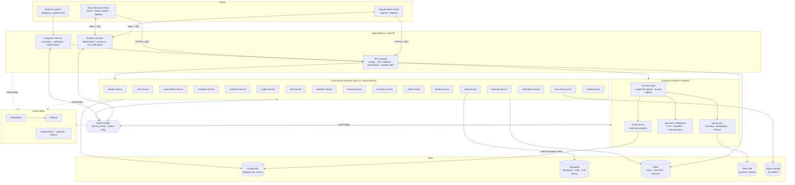
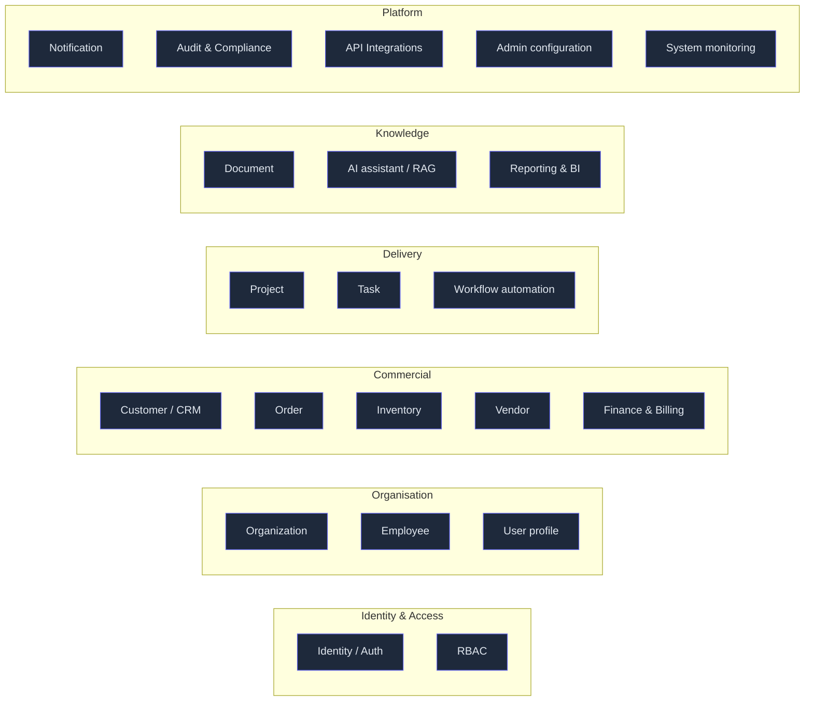
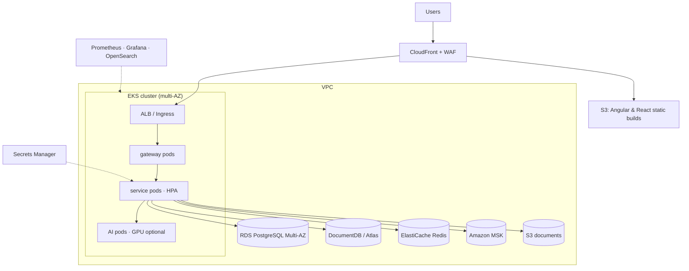

# 01 — System Architecture

NEXUS Enterprise is a multi-tenant, AI-assisted business platform made of independently deployable services.
This document is the entry point to the architecture. Related documents:

| Doc | Topic |
| --- | --- |
| [02-microservices.md](02-microservices.md) | Service catalogue, ownership, ports, data stores |
| [03-api-communication.md](03-api-communication.md) | REST / GraphQL / WebSocket / Kafka contracts |
| [04-authentication.md](04-authentication.md) | Identity, tokens, RBAC, multi-tenancy, rate limiting |
| [05-ai-architecture.md](05-ai-architecture.md) | RAG, agents, NL→SQL safeguards, evaluation |
| [06-roadmap.md](06-roadmap.md) | Phased delivery plan and exit criteria |
| [decisions.md](decisions.md) | Architecture Decision Records (ADRs) |
| [../database/database-architecture.md](../database/database-architecture.md) | Data architecture and ERDs |

---

## 1. Goals and quality attributes

| Attribute | Target / approach |
| --- | --- |
| **Security** | Zero-trust between services: every request carries a verifiable JWT; tenant isolation enforced in every query; OWASP ASVS L2 as the baseline. |
| **Scalability** | Stateless services, horizontal pod autoscaling, Kafka for asynchronous fan-out, Redis for hot reads. |
| **Availability** | No single point of failure in production (multi-AZ RDS, MSK, EKS node groups across AZs). Target 99.9 %. |
| **Modifiability** | Bounded contexts per service, database-per-service, contracts versioned (`/api/v1`), events versioned (`eventVersion`). |
| **Observability** | Structured JSON logs with `traceId`/`tenantId`, Prometheus metrics, OpenTelemetry traces, ELK for search. |
| **Auditability** | Every state-changing command emits an audit event; audit store is append-only. |
| **AI safety** | AI never writes business data directly; it proposes actions that go through the same authorised APIs. NL→SQL is read-only on replica views. |

## 2. High-level architecture

### Request flow (synchronous)

1. Client authenticates against `identity-service` (through the gateway) and receives a short-lived **RS256 access token** plus a rotating **refresh token**.
2. Every API call goes to the **API Gateway**, which validates the token against identity-service's **JWKS**, applies **per-tenant / per-user rate limits** (Redis), injects `X-Correlation-Id`, and routes to the owning service.
3. The owning service **re-validates the JWT** (defence in depth), resolves `tenantId` from the token, checks **permissions**, executes the use case, and writes to its own database.
4. State changes are written to an **outbox table** in the same transaction and relayed to **Kafka**.

### Event flow (asynchronous)

`order-service` writes `OrderPlaced` → outbox → Kafka `nexus.order.events` →
`inventory-service` reserves stock, `finance-service` creates an invoice draft, `notification-service` notifies the customer, `audit-service` records it, `reporting-service` updates read models, `rag-service` (optionally) indexes order notes.

## 3. Bounded contexts

Context relationships:

- **Identity & Access** is *upstream* of everything (published language: JWT claims `sub`, `tid`, `roles`, `perms`).
- **Organisation** owns tenants' structure; Commercial and Delivery reference `organizationId` / `employeeId` by ID only (no cross-DB joins).
- **Knowledge** consumes events from all contexts (conformist) to build search indexes and read models.
- **Platform** services are generic subdomains consumed by all.

## 4. Module → service mapping

| # | Business module | Owning service(s) | Stack |
| --- | --- | --- | --- |
| 1 | User & Identity Management | identity-service, user-service | Java |
| 2 | Role-Based Access Control | identity-service | Java |
| 3 | Organization Management | organization-service | Java |
| 4 | Employee Management | employee-service | Java |
| 5 | CRM | customer-service | Java |
| 6 | Project Management | project-service | Java |
| 7 | Task Management | task-service | Java |
| 8 | Workflow Automation | workflow-service (+ background workers in Node) | Java / Node |
| 9 | Finance & Billing | finance-service | Java |
| 10 | Inventory | inventory-service | Java |
| 11 | Orders | order-service | Java |
| 12 | Vendors | vendor-service | Java |
| 13 | Document Management | document-service | Java |
| 14 | Reporting & Analytics | reporting-service | Java |
| 15 | Notifications | notification-service (+ realtime-service delivery) | Java / Node |
| 16 | Audit & Compliance | audit-service | Java |
| 17 | API Integration Management | integration-service | Node |
| 18 | AI Assistant | ai-orchestrator | Python |
| 19 | AI Document Processing | document-intelligence | Python |
| 20 | AI Business Intelligence | nl-sql-service, reporting-service | Python / Java |
| 21 | AI Knowledge Management | rag-service | Python |
| 22 | Real-time Collaboration | realtime-service | Node |
| 23 | Admin Configuration | config-service | Java |
| 24 | System Monitoring | Prometheus, Grafana, ELK, actuator endpoints | Infra |

## 5. Cross-cutting concerns

| Concern | Standard |
| --- | --- |
| Error format | RFC 9457 `application/problem+json` with `code`, `traceId`, `errors[]` |
| IDs | UUID v4 (application-generated) for all aggregate roots |
| Time | UTC `timestamptz`, ISO-8601 in APIs |
| Money | `numeric(19,4)` + ISO-4217 currency code; never floating point |
| Pagination | `page`, `size` (max 100), `sort`; responses include `totalElements`, `totalPages` |
| Tenancy | `tenant_id` column on every tenant-owned table; tenant resolved from JWT `tid`, never from request body |
| Soft delete | `deleted_at` on business aggregates; hard delete only through retention jobs |
| Optimistic locking | `version` column on mutable aggregates |
| Logging | JSON, no PII/secrets, `traceId`, `tenantId`, `userId` in MDC |
| Config | 12-factor: environment variables, Kubernetes Secrets / AWS Secrets Manager in prod |

## 6. Deployment view (target)

Infrastructure is provisioned with Terraform (`infrastructure/terraform`) and deployed with Helm/Kustomize manifests (`infrastructure/kubernetes`) from GitHub Actions.
