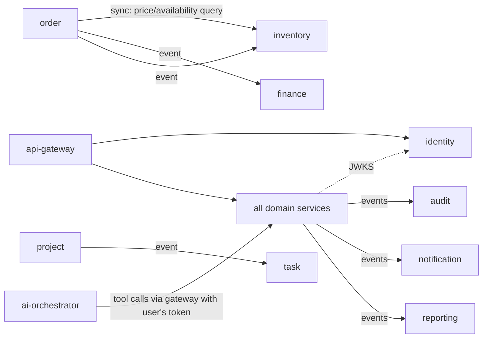

# 02 — Microservices Architecture

## 1. Principles

- **One service = one bounded context = one database.** No service reads another service's tables.
- **Synchronous calls only for queries the user is waiting on**; everything else is an event.
- **Transactional outbox** for every published event (no dual writes).
- **Idempotent consumers** keyed by `eventId` (processed-events table per consumer).
- **Hexagonal layout** in every Java service:

```text
com.nexus.<service>
├── api/            REST controllers, request/response DTOs, mappers   (adapters in)
├── application/    use cases / application services, ports            (orchestration)
├── domain/         entities, value objects, domain services, events   (pure business rules)
└── infrastructure/ JPA repositories, Kafka, external clients, config  (adapters out)
```

## 2. Service catalogue

Ports are the local-development defaults (`docker-compose.yml`). In Kubernetes every service listens on 8080.

### Java / Spring Boot services

| Service | Port | Responsibility | Data store | Publishes | Consumes |
| --- | --- | --- | --- | --- | --- |
| **identity-service** | 8081 | Authentication, tenants, users' credentials, roles, permissions, refresh tokens, JWKS | PostgreSQL `identity_db` | `UserRegistered`, `UserLocked`, `RoleAssigned`, `TenantCreated` | — |
| user-service | 8082 | User profiles, preferences, avatars | PostgreSQL `user_db` | `UserProfileUpdated` | `UserRegistered` |
| organization-service | 8083 | Organisations, departments, locations, org chart | PostgreSQL `organization_db` | `DepartmentCreated` | `TenantCreated` |
| employee-service | 8084 | Employees, positions, contracts, leave | PostgreSQL `employee_db` | `EmployeeHired`, `EmployeeTerminated` | `DepartmentCreated`, `UserRegistered` |
| customer-service | 8085 | Accounts, contacts, leads, opportunities, activities | PostgreSQL `customer_db` | `LeadConverted`, `CustomerCreated` | `OrderPlaced` |
| project-service | 8086 | Projects, milestones, members, risks | PostgreSQL `project_db` | `ProjectCreated`, `MilestoneReached` | `TaskCompleted`, `RiskPredicted` |
| task-service | 8087 | Tasks, sub-tasks, comments, time logs, boards | PostgreSQL `task_db` | `TaskAssigned`, `TaskCompleted` | `ProjectCreated` |
| workflow-service | 8088 | Workflow definitions (BPMN-lite), approvals, SLA timers | PostgreSQL `workflow_db` | `ApprovalRequested`, `WorkflowCompleted` | any domain event (triggers) |
| finance-service | 8089 | Chart of accounts, invoices, payments, taxes, ledgers | PostgreSQL `finance_db` | `InvoiceIssued`, `PaymentReceived` | `OrderPlaced`, `PurchaseOrderApproved` |
| inventory-service | 8090 | Products, warehouses, stock levels, movements, reservations | PostgreSQL `inventory_db` | `StockReserved`, `StockLow` | `OrderPlaced`, `OrderCancelled`, `GoodsReceived` |
| order-service | 8091 | Sales orders, order lines, fulfilment state machine | PostgreSQL `order_db` | `OrderPlaced`, `OrderShipped`, `OrderCancelled` | `StockReserved`, `PaymentReceived` |
| vendor-service | 8092 | Vendors, purchase orders, goods receipts, vendor scoring | PostgreSQL `vendor_db` | `PurchaseOrderApproved`, `GoodsReceived` | `StockLow` |
| document-service | 8093 | Files, folders, versions, sharing, retention labels | PostgreSQL `document_db` + S3/MinIO | `DocumentUploaded`, `DocumentDeleted` | — |
| reporting-service | 8094 | Report definitions, scheduled reports, KPI read models | PostgreSQL `reporting_db` | `ReportGenerated` | all domain events (projections) |
| notification-service | 8095 | Templates, channels (email/SMS/in-app), preferences, delivery log | PostgreSQL `notification_db` | `NotificationRequested` | all user-facing events |
| audit-service | 8096 | Immutable audit trail, compliance exports, retention | MongoDB `audit` | — | `*.events`, `nexus.audit.events` |
| config-service | 8097 | Tenant settings, feature flags, system parameters | PostgreSQL `config_db` + Redis cache | `ConfigChanged` | — |

### Node.js / NestJS services

| Service | Port | Responsibility |
| --- | --- | --- |
| api-gateway | 8080 | Single entry point; JWT validation via JWKS; Redis rate limiting; request routing; CORS; GraphQL BFF aggregating dashboard queries |
| realtime-service | 8070 | Socket.IO/WebSocket gateway; presence; live notifications and collaborative editing channels; bridges Kafka → sockets |
| integration-service | 8071 | Connector registry, outbound webhooks with signing + retries, inbound webhooks, third-party OAuth client credentials |
| worker-service | — | BullMQ background jobs: email sending, report rendering, scheduled workflow timers |

### Python / FastAPI services

| Service | Port | Responsibility |
| --- | --- | --- |
| ai-orchestrator | 8000 | Chat endpoint, LangChain agents & tools, prompt registry, guardrails, conversation memory (MongoDB) |
| rag-service | 8001 | Ingestion pipeline, chunking, embeddings, hybrid retrieval (BM25 + vector), re-ranking, citations |
| document-intelligence | 8002 | PDF/Office parsing, OCR, entity extraction, classification, summarisation |
| nl-sql-service | 8003 | Natural-language → SQL over curated **read-only analytics views**, query validation, row limits |

## 3. Inter-service dependency rules



Rules:

1. Domain services may call other domain services synchronously **only for reads**, with a timeout (≤ 2 s), retry (≤ 2), and circuit breaker (Resilience4j).
2. AI services act **on behalf of the user** — they forward the user's access token, so the AI can never exceed the user's permissions.
3. No service may depend on `audit-service`, `notification-service`, or `reporting-service` synchronously.

## 4. Shared Java module: `platform-common`

Deliberately small to avoid a distributed monolith:

| Package | Contents |
| --- | --- |
| `com.nexus.common.error` | `ApiException`, `ErrorCode`, RFC 9457 `ProblemDetail` handler |
| `com.nexus.common.tenant` | `TenantContext` (resolved from JWT `tid` claim) |
| `com.nexus.common.web` | `CorrelationIdFilter` (`X-Correlation-Id` → MDC) |
| `com.nexus.common.event` | `DomainEventEnvelope` record (event contract) |

Business logic is **never** placed in the shared module.

## 5. Service template checklist

Every new Java service must have before it is marked complete in `DEVELOPMENT_STATUS.md`:

- [ ] Flyway migrations (`src/main/resources/db/migration`)
- [ ] OpenAPI docs at `/swagger-ui.html`
- [ ] Bean Validation on all request DTOs
- [ ] ProblemDetail error handling via `platform-common`
- [ ] Tenant isolation test (tenant A cannot read tenant B)
- [ ] Unit tests (domain/application) + integration tests (Testcontainers PostgreSQL)
- [ ] Actuator health/readiness/liveness + Prometheus metrics
- [ ] Dockerfile + compose entry + Kubernetes manifest
- [ ] CI job green
