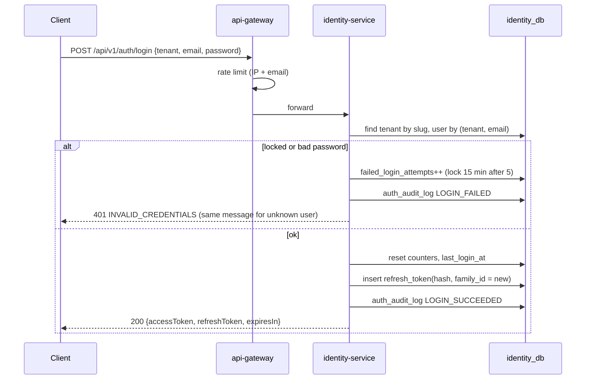
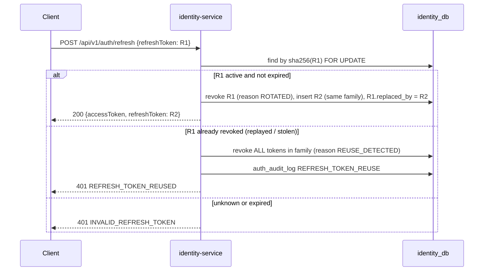
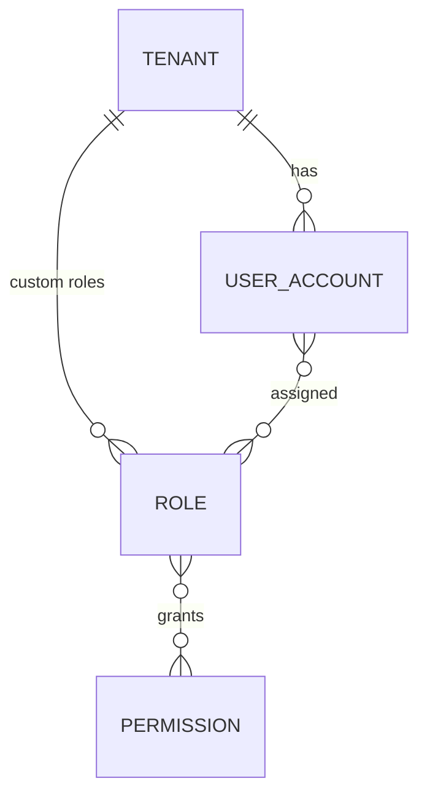

# 04 — Authentication, Authorization & Multi-Tenancy

> Status: the token model, refresh rotation, RBAC and tenant model described in §2–§5 are **implemented in `identity-service`** (see `DEVELOPMENT_STATUS.md`). OAuth2/OIDC federation (§6) and gateway-level Redis rate limiting (§7) are designed here and scheduled for Phase 4 / Phase 6.

## 1. Components

| Component | Role |
| --- | --- |
| identity-service | Issues tokens, owns credentials, tenants, roles, permissions, refresh-token families, auth audit log, JWKS |
| api-gateway | Validates JWT signature/expiry via cached JWKS, rate-limits, forwards token |
| every service | Acts as an OAuth2 **resource server**: re-validates JWT, maps `perms` claim to authorities, enforces `tid` on every query |

## 2. Tokens

| Token | Format | Lifetime | Storage (client) |
| --- | --- | --- | --- |
| Access token | JWT, **RS256**, `kid` header | 15 min | Memory only (never localStorage) |
| Refresh token | Opaque 256-bit random (base64url); server stores **SHA-256 hash** only | 14 days, rotated on every use | `HttpOnly; Secure; SameSite=Strict` cookie set by gateway (portals) or secure storage (API clients) |

Access-token claims:

```json
{
  "iss": "https://identity.nexus.local",
  "sub": "4b8e…-user-uuid",
  "tid": "9a2c…-tenant-uuid",
  "email": "admin@acme.test",
  "roles": ["TENANT_ADMIN"],
  "perms": ["identity.user.create", "identity.user.read", "identity.role.read"],
  "iat": 1795670000,
  "exp": 1795670900,
  "jti": "e3b0…"
}
```

Why RS256 + JWKS: services verify tokens with the **public** key only; the private key never leaves identity-service; keys rotate by publishing a new `kid` alongside the old one.

## 3. Flows

### Login



### Refresh-token rotation with reuse detection



If an attacker steals R1 and uses it after the legitimate client has rotated to R2 (or vice versa), the second use of R1 kills the whole family — both parties must log in again.

### Logout

`POST /api/v1/auth/logout {refreshToken}` revokes the token's whole family (reason `LOGOUT`). Access tokens expire naturally (≤ 15 min); a Redis deny-list of `jti` is planned for immediate revocation of high-risk sessions.

### Service-to-service

- On behalf of a user (AI tools, BFF): forward the user's access token.
- Machine jobs (workers, outbox relays calling APIs): OAuth2 **client-credentials** tokens with `tid` and narrowly-scoped `perms` (Phase 4).

## 4. RBAC model



- **Permissions** are global, code-defined strings: `<service>.<resource>.<action>`, e.g. `finance.invoice.approve`.
- **System roles** (`tenant_id IS NULL`) ship with migrations: `TENANT_ADMIN`, `MANAGER`, `EMPLOYEE`, `CUSTOMER`, `AUDITOR`.
- **Custom roles** are per tenant.
- Authorisation is checked on **permissions**, never role names: `@PreAuthorize("hasAuthority('identity.user.create')")`.
- Row-level rules (e.g. "only own tasks") live in each service's application layer.

## 5. Multi-tenancy

| Decision | Detail |
| --- | --- |
| Model | Shared database per service, shared schema, `tenant_id` discriminator column |
| Resolution | From JWT `tid` only — never from headers or request bodies for authenticated calls |
| Enforcement | Repository methods always take `tenantId`; integration tests assert cross-tenant reads return 404 |
| Defence in depth (Phase 3+) | PostgreSQL Row-Level Security policies using `SET app.tenant_id` per transaction |
| Uniqueness | Business keys unique per tenant, e.g. `UNIQUE (tenant_id, email_normalized)` |
| Large tenants | Can be promoted to a dedicated database by routing datasource on `tid` (future) |

## 6. OAuth2 / OIDC (Phase 4)

- **Federated login**: tenants can configure an external OIDC provider (Azure AD, Google Workspace, Okta). identity-service acts as the broker: it validates the external ID token, maps/creates the local account, then issues NEXUS tokens — so downstream services see one token format.
- **Client credentials** for machine clients and partner API keys (hashed secrets, per-client scopes, rotation).
- Authorization-code + PKCE for any future third-party apps.

## 7. Abuse protection

| Control | Where | Status |
| --- | --- | --- |
| Per-IP fixed-window limit on `/auth/login`, `/auth/refresh`, `/tenants` | identity-service (in-memory) | Implemented |
| Account lockout: 5 failures → 15 min | identity-service | Implemented |
| Uniform error for unknown user vs bad password | identity-service | Implemented |
| Distributed per-tenant / per-user quotas (Redis token bucket) | api-gateway | Phase 6 |
| WAF rules, bot control | AWS WAF | Phase 14 |

## 8. Passwords & secrets

- Passwords: **BCrypt (cost 12)** via Spring `DelegatingPasswordEncoder` (algorithm prefix stored, so we can migrate to Argon2id without a reset). Policy: 12–128 chars, must contain letter + digit.
- Secrets: never committed. Local: `.env` (git-ignored, `.env.example` documents keys). Kubernetes: Secrets (sealed / External Secrets Operator). AWS: Secrets Manager.
- RSA signing keys: provided via `NEXUS_JWT_PRIVATE_KEY` / `NEXUS_JWT_PUBLIC_KEY` (PEM). In dev, if unset, an **ephemeral** key pair is generated at startup and a warning is logged (tokens do not survive restarts).

## 9. OWASP mapping (selected)

| OWASP Top 10 | Mitigation |
| --- | --- |
| A01 Broken access control | Permission checks on every endpoint, tenant from token, cross-tenant tests |
| A02 Cryptographic failures | RS256, TLS everywhere, hashed refresh tokens, BCrypt |
| A03 Injection | JPA parameter binding only; NL→SQL limited to validated SELECT on views |
| A04 Insecure design | Threat model per service (docs/architecture), outbox instead of dual writes |
| A05 Security misconfiguration | Actuator exposure limited to health/info/prometheus; CORS allow-list |
| A07 Identification & auth failures | Lockout, rate limit, rotation + reuse detection, short-lived access tokens |
| A08 Integrity failures | Signed webhooks (HMAC), pinned CI actions, dependency scanning |
| A09 Logging & monitoring failures | Auth audit log, structured logs, alerts on reuse detection |
