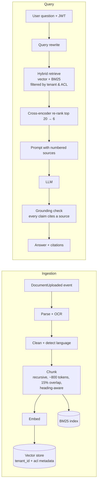
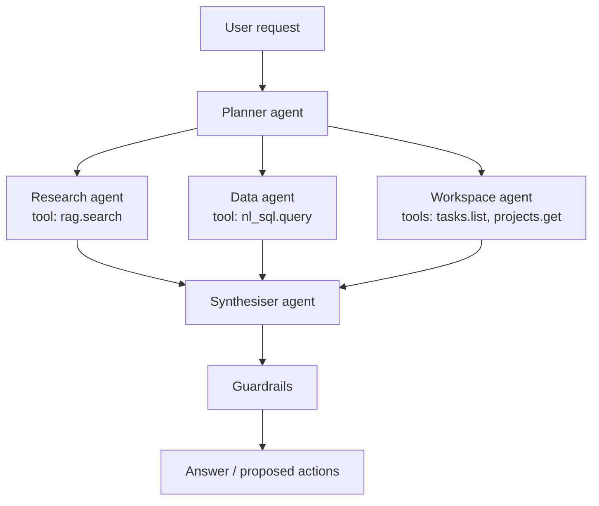

# 05 — AI Architecture (Python / FastAPI)

> Status: design only. Implementation is Phase 9.

## 1. Services

| Service | Key libraries | Responsibility |
| --- | --- | --- |
| ai-orchestrator | FastAPI, LangChain, Pydantic | Chat API, agent loop, tool registry, prompt registry, guardrails, conversation memory |
| rag-service | LangChain text splitters, sentence-transformers / provider embeddings, pgvector or Qdrant | Ingestion, chunking, embeddings, hybrid retrieval, re-ranking, citations |
| document-intelligence | pypdf / pdfplumber, unstructured, Tesseract OCR | Parse, OCR, classify, extract entities, summarise |
| nl-sql-service | sqlglot, SQLAlchemy | NL → SQL on curated read-only views with strict validation |

LLM access goes through a **provider abstraction** (OpenAI-compatible, Anthropic, Azure OpenAI, local vLLM). Keys come from Secrets Manager.

## 2. RAG pipeline

Every chunk stores `tenant_id`, `document_id`, `version`, `acl` (role/user IDs), `page`, `section`. Retrieval **filters by tenant and ACL before similarity search**, so the model never sees documents the user cannot open.

## 3. Hallucination safeguards

1. **Grounded prompting** — system prompt requires answers only from numbered sources; "I don't know" is an allowed answer.
2. **Citation enforcement** — responses are parsed; sentences without a valid `[n]` citation are flagged; if coverage < threshold the answer is downgraded to "insufficient evidence".
3. **Retrieval confidence gate** — if the best re-rank score is below threshold, skip generation and say no relevant documents were found.
4. **Structured outputs** — summaries, task recommendations and risk predictions use Pydantic schemas with validation + one repair attempt.
5. **No direct writes** — agents can only *propose* actions; the user confirms, and execution goes through normal REST APIs with the user's token.

## 4. Agents and tools

Tools are declared with JSON schemas, permission requirements, and timeouts. A tool call is denied if the user lacks the permission (`tool.requiredPermission ∈ jwt.perms`). Max 8 tool steps per request.

## 5. NL → SQL (read-only)

| Control | Implementation |
| --- | --- |
| Separate DB role | `nexus_analytics_ro` with `SELECT` only on `analytics.*` views |
| Curated views | Only denormalised, PII-minimised views; tenant filter built into views via `current_setting('app.tenant_id')` |
| Parse & validate | `sqlglot` AST: single `SELECT`, no DDL/DML, no `pg_*`/system catalogs, allow-listed tables/columns only |
| Limits | Forced `LIMIT 1000`, `statement_timeout = 5s`, read replica |
| Transparency | Generated SQL shown to the user with results |

## 6. Prompt management and evaluation

- Prompts stored as versioned templates (`prompt_id`, `version`, `model`, `variables`) in MongoDB; every response logs the prompt version.
- Offline evaluation set per feature (question, expected sources, reference answer) run in CI: retrieval recall@k, answer faithfulness, citation precision, refusal correctness.
- Online: thumbs up/down, "report wrong answer", latency and token cost dashboards in Grafana.

## 7. Feature map

| Feature | Service(s) |
| --- | --- |
| Enterprise chatbot | ai-orchestrator |
| RAG knowledge assistant, smart search | rag-service |
| PDF/document Q&A, summarisation | document-intelligence + rag-service |
| AI report generation | ai-orchestrator + reporting-service |
| NL SQL assistant | nl-sql-service |
| Task recommendations, project risk prediction | ai-orchestrator (features from task/project events; gradient-boosted baseline + LLM explanation) |
| AI customer support | ai-orchestrator + customer-service + rag-service |
| Multi-agent workflows | ai-orchestrator + workflow-service |
