# 06 — Development Roadmap

Each phase ends with an **exit criterion**. A phase is only marked complete in `DEVELOPMENT_STATUS.md` when its exit criterion is met and CI is green.

| Phase | Scope | Key deliverables | Exit criterion |
| --- | --- | --- | --- |
| **1. Architecture & requirements** | Architecture package, ADRs, roadmap | `docs/architecture/*`, `docs/database/*` | Docs reviewed and committed |
| **2. Repository structure** | Monorepo, root tooling, compose, CI skeleton | Folder tree, `docker-compose.yml`, Java parent build, CI workflow | `docker compose up` starts infra; CI green |
| **3. Database architecture** | Schemas for all 24 modules, Flyway per service, seed data, retention | `database/schemas/*`, migrations in each service | Migrations apply on clean Postgres in CI |
| **4. Authentication & security** | identity-service hardening, OIDC federation, client credentials, RLS | Federation, client-credentials, `jti` deny-list, RLS policies | Security test suite green |
| **5. Java microservices** | Domain services in dependency order (see below) | Each service meets the template checklist | Per-service CI + tenant-isolation tests green |
| **6. Node.js services** | api-gateway, realtime, integration, workers | NestJS apps with tests | E2E: login via gateway, live notification over WS |
| **7. Angular admin portal** | Admin dashboard and management screens | Angular app wired to real APIs | Playwright E2E on admin flows |
| **8. React business portal** | Customer/business workspace | React app wired to real APIs | Playwright E2E on portal flows |
| **9. Generative AI** | Orchestrator, RAG, document intelligence, NL-SQL | FastAPI services, eval sets | Eval thresholds met in CI |
| **10. Kafka event architecture** | Outbox relays, consumers, sagas, DLTs | Event contracts, consumer tests | Order saga E2E passes |
| **11. Docker & Kubernetes** | Images, Helm/Kustomize, HPA, probes | `infrastructure/kubernetes/*` | Deploy to kind in CI |
| **12. CI/CD** | Build, test, scan, publish images, deploy | GitHub Actions pipelines | Main branch auto-deploys to staging |
| **13. Automated testing** | Contract, performance (k6), security (ZAP) | `testing/*` | Baselines recorded, gates enforced |
| **14. AWS deployment** | Terraform: VPC, EKS, RDS, MSK, ElastiCache, S3, CloudFront | `infrastructure/terraform/*` | Staging environment live |
| **15. Production readiness** | Runbooks, SLOs, dashboards, alerts, user guides | `docs/deployment`, `docs/user-guides` | Readiness checklist signed off |

## Service build order (Phase 5)

Ordered by dependency so each service can be integration-tested against real upstreams:

```mermaid
flowchart LR
    identity --> organization --> employee
    identity --> user
    organization --> customer --> order
    inventory --> order
    vendor --> inventory
    order --> finance
    organization --> project --> task --> workflow
    identity --> document
    identity --> notification
    identity --> audit
    identity --> config
    order & task & finance --> reporting
```

1. identity-service ✅ (started in Phase 1/2 as the reference implementation)
2. organization-service → user-service → employee-service
3. audit-service, notification-service, config-service (platform services everyone emits to)
4. customer-service → vendor-service → inventory-service → order-service → finance-service
5. project-service → task-service → workflow-service
6. document-service → reporting-service

## Working agreement

- Before each module: write a short "dependencies & integration" note in its README (what it calls, what it publishes/consumes, which permissions it defines).
- Small PR-sized increments; every increment updates `DEVELOPMENT_STATUS.md`.
- Nothing is marked done without passing tests in CI.
