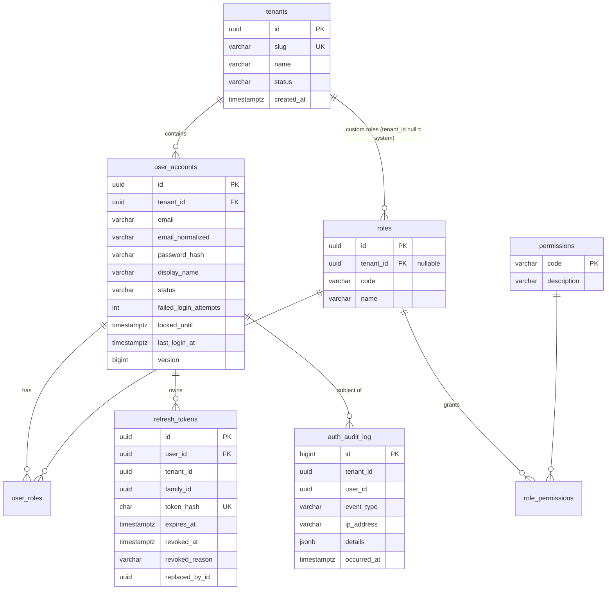
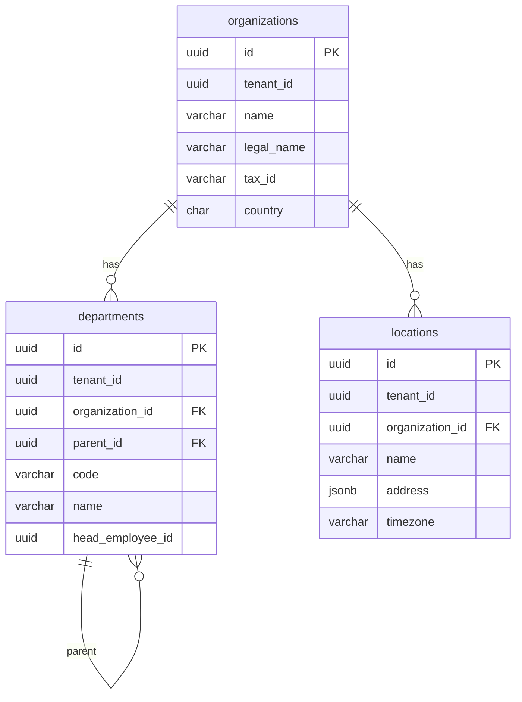
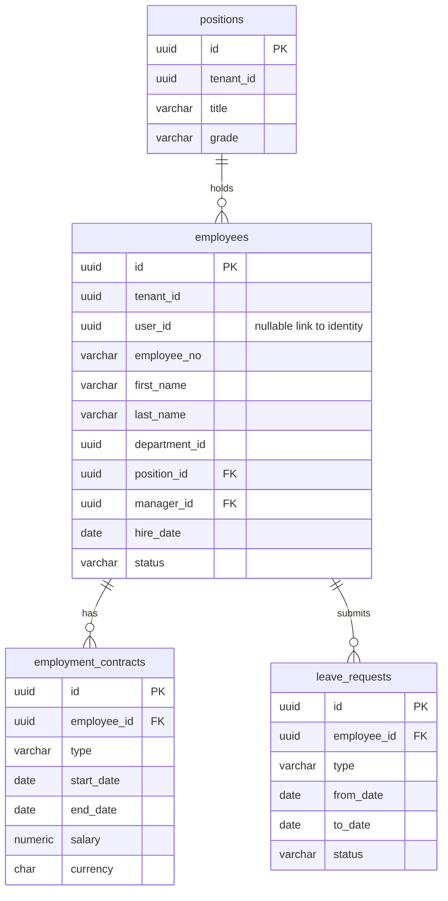
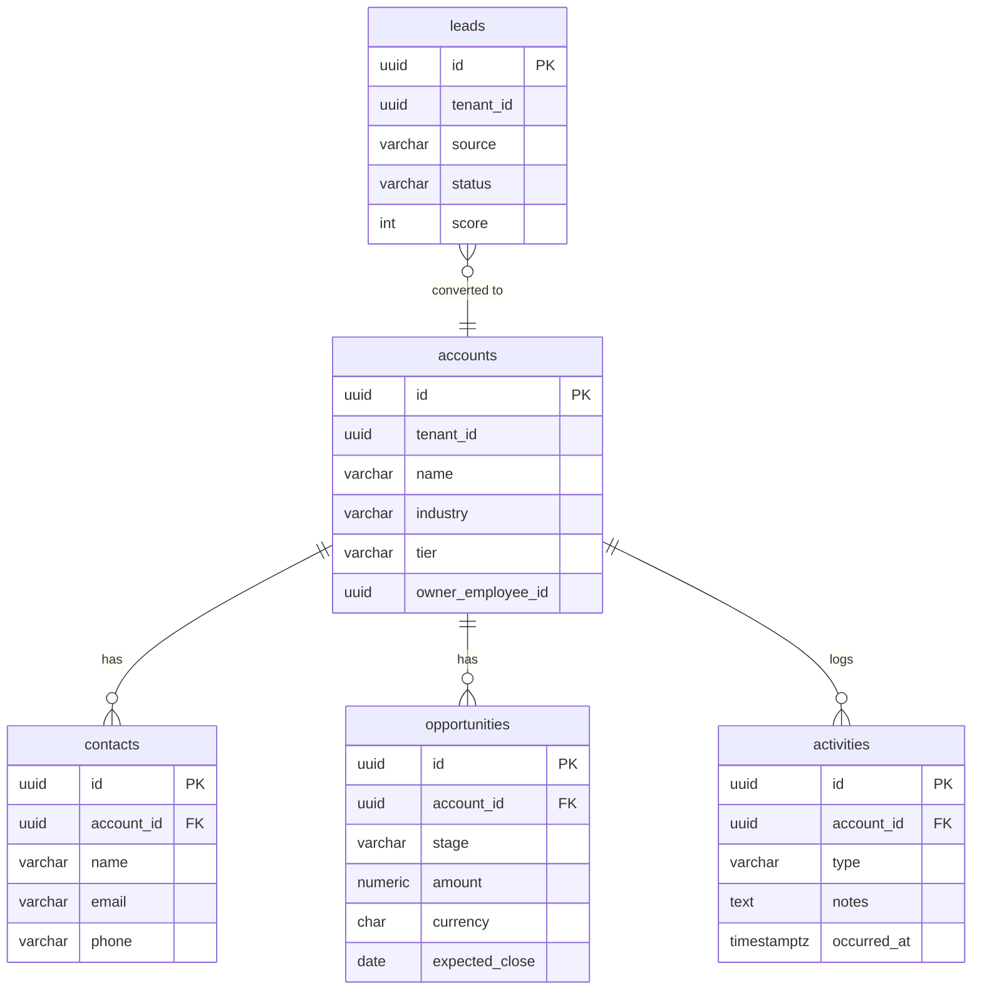
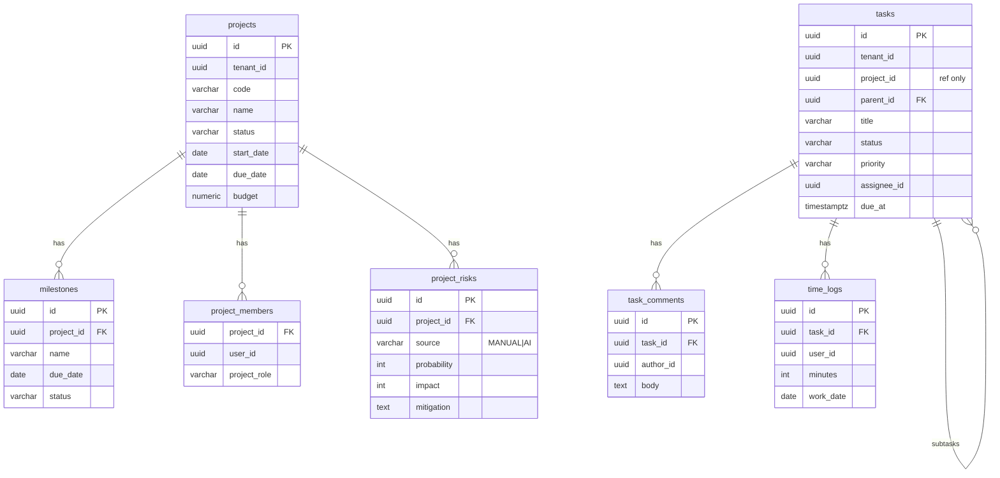
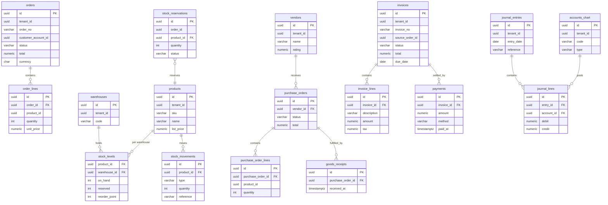

# Database Architecture

> Status: `identity_db` is implemented (Flyway migrations in `backend/java-services/identity-service`). Other schemas below are the **logical design** that Phase 3 turns into migrations, one service at a time.

## 1. Stores

| Store | Used by | Why |
| --- | --- | --- |
| PostgreSQL 16 | All transactional services (one database each) | ACID, constraints, JSONB, RLS, pgvector |
| MongoDB 7 | audit-service, ai-orchestrator (conversations, prompts) | Append-heavy, flexible documents |
| Redis 7 | gateway rate limits, config cache, sessions/presence, idempotency keys | Low-latency ephemeral state |
| Vector DB (pgvector → Qdrant) | rag-service | Embedding similarity search |
| S3 / MinIO | document-service | Binary files and versions |

## 2. Conventions (all PostgreSQL schemas)

| Rule | Example |
| --- | --- |
| PK `id uuid` (app-generated) | `id uuid PRIMARY KEY` |
| Tenant column on tenant-owned tables | `tenant_id uuid NOT NULL` + index leading with `tenant_id` |
| Audit columns | `created_at timestamptz NOT NULL DEFAULT now()`, `updated_at`, `created_by uuid` |
| Optimistic lock | `version bigint NOT NULL DEFAULT 0` |
| Soft delete | `deleted_at timestamptz NULL`; unique indexes are partial `WHERE deleted_at IS NULL` |
| Enums | `varchar(32)` + `CHECK` constraint (easy to evolve; no PG enum migrations) |
| Money | `numeric(19,4)` + `currency char(3)` |
| Names | snake_case, plural tables, `fk_<table>_<ref>`, `ix_<table>_<cols>`, `uq_<table>_<cols>` |
| Outbox | every publishing service has `outbox_events` |
| Idempotent consumers | every consuming service has `processed_events(event_id PK, processed_at)` |
| Migrations | Flyway `V<n>__<description>.sql`, forward-only; dev seed data in `db/seed` enabled only by the `dev` profile |

## 3. identity_db (implemented)

Plus `outbox_events` (events awaiting the Phase 10 relay).

## 4. Logical schemas for remaining services

### organization_db

### employee_db

### customer_db (CRM)

### project_db / task_db

### order_db / inventory_db / vendor_db / finance_db

Finance invariant enforced by a deferred constraint trigger: `SUM(debit) = SUM(credit)` per journal entry.

### Other services (summary)

| Database | Core tables |
| --- | --- |
| workflow_db | `workflow_definitions(versioned JSON)`, `workflow_instances`, `workflow_steps`, `approvals`, `sla_timers` |
| document_db | `folders`, `documents`, `document_versions(storage_key, checksum, size)`, `document_shares`, `retention_labels` |
| reporting_db | `report_definitions`, `report_runs`, `kpi_daily(tenant_id, metric, date, value)`, projection tables |
| notification_db | `templates`, `notifications`, `delivery_attempts`, `user_channel_preferences` |
| config_db | `tenant_settings(key, value jsonb)`, `feature_flags`, `system_parameters` |
| integration (Mongo/PG) | `connectors`, `webhook_subscriptions(secret_hash)`, `webhook_deliveries` |
| audit (MongoDB) | `audit_events` — immutable, `{eventId, tenantId, actor, action, resource, before, after, ip, at}`; TTL per tenant policy |
| ai (MongoDB) | `conversations`, `messages`, `prompt_templates`, `feedback`, `eval_runs` |
| vectors | `chunks(id, tenant_id, document_id, version, page, acl[], embedding vector(1536), text)` with HNSW index |

## 5. Indexing strategy

- Every tenant-owned query path has a composite index **leading with `tenant_id`** (e.g. `ix_tasks_tenant_assignee_status (tenant_id, assignee_id, status)`).
- Partial unique indexes for soft-deleted rows.
- `GIN` on JSONB attributes that are filtered; `pg_trgm` GIN for fuzzy name search.
- Time-series tables (`auth_audit_log`, `stock_movements`, `kpi_daily`) are range-partitioned by month once they exceed ~50 M rows.

## 6. Data retention policies

| Data | Retention | Mechanism |
| --- | --- | --- |
| Refresh tokens (expired/revoked) | 30 days after expiry | Scheduled purge job in identity-service |
| Auth audit log | 1 year hot, 7 years archived (S3 Glacier) | Monthly partitions detached → export |
| Business audit events (Mongo) | Tenant-configurable, default 7 years | TTL index + archive export |
| Soft-deleted business records | 90 days, then hard delete or anonymise | Retention job per service |
| Outbox rows | 7 days after publish | Relay cleanup |
| AI conversations | 180 days default, tenant-configurable; PII redacted in logs | TTL index |
| Uploaded documents | Per retention label (e.g. contracts 10 years) | document-service lifecycle + S3 lifecycle rules |
| Application logs (ELK) | 30 days hot, 90 days warm | ILM policy |

GDPR "right to erasure": each service exposes an internal `ErasureRequested` consumer that anonymises personal data for a user ID while preserving financial records required by law.
